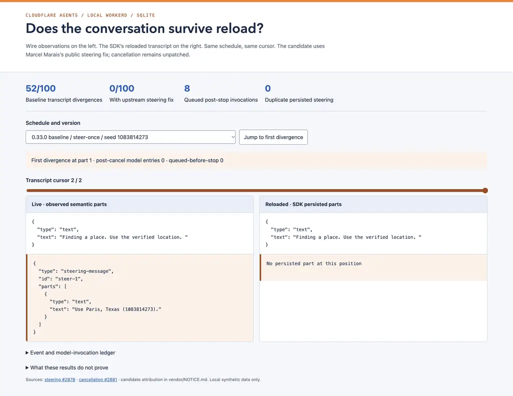
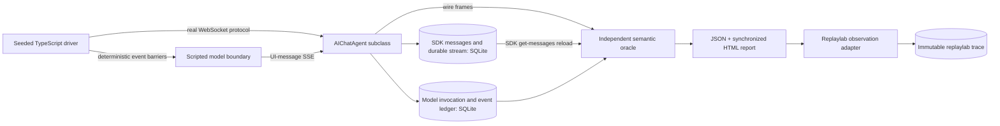

# TurnLedger for Cloudflare Agents

A lifecycle conformance adapter for [replaylab](vendor/NOTICE.md): compare what a chat client received with what the Agents SDK actually reloads from SQLite.

For engineers building durable chat, [Agents #2878](https://github.com/cloudflare/agents/issues/2878) reports steering messages disappearing after reload. [PR #2881](https://github.com/cloudflare/agents/pull/2881) separately addresses queued continuations restarting the model after Stop. Both already have upstream authors. This project tests their surrounding lifecycle contracts; it does not claim either fix.

**52/100 transcript divergences on `agents@0.33.0`; 0/100 with Marcel Marais’s public steering fix.** Same 100 seeded schedules, real local workerd, real SDK stream processing and disk-backed SQLite. Only the model boundary is scripted.

```sh
npm ci
npm run demo
```

Captured output excerpt ([fresh-clone log](evidence/clean-clone.txt), seed 42; timing is machine-specific):

```text
baseline: 52/100 transcript divergences; 24 post-cancel model entries (8 queued before stop); 0 duplicate persisted steering chunks
upstream steering fix: 0/100 transcript divergences; 24 post-cancel model entries (8 queued before stop); 0 duplicate persisted steering chunks
replaylab: 200 observations replayed; 0 effects during replay
disk restart: both versions preserved exact messages and ledger
duration: 53555 ms; 100 seeded schedules × 2 versions; 12 cases
```

The steering-only candidate **does not fix cancellation**. Of 24 post-cancel model entries, 16 follow new tool results submitted after Stop and are allowed by #2881’s stated policy. The other 8 follow results already queued before Stop. Those remain visible as findings, not folded into a passing average.



## Try it

Requires Node.js 22+, npm and Python 3.12+. No Cloudflare account, API key, LLM, Docker or deployment. Dependency installation needs network access; all tests and demos then run locally without provider calls. The Python adapter imports the vendored replaylab wheel’s standard-library-only engine/store; it does not install its optional HTTP/UI dependencies.

- `npm run demo` — 100 seeded schedules per version; about 54 seconds in the captured run. Starts and stops its own isolated Wrangler runtimes.
- `npm run demo -- 12 42` — all twelve cases once, about 8 seconds in the small captured run.
- Open `artifacts/report.html` directly. Select baseline or candidate, move the **Transcript cursor**, or jump to the first divergence. The cursor synchronizes semantic parts, not wall-clock playback. Expand the raw event/model-entry ledger for ordering.
- `npm run check` — formatting, TypeScript and behavioural tests, including a full runtime stop/restart against the same SQLite directory.
- `npm run dev` — manually explore the synthetic worker at loopback. Stop with Ctrl-C. This command is not needed by the demo.
- `python3 scripts/replaylab_adapter.py artifacts/report.json artifacts/replaylab.sqlite` — archive and replay completed observations without re-executing Worker effects.

Generated files are ignored: raw frames and ledgers in `artifacts/report.json`, synchronized HTML, and replaylab’s own SQLite trace. Actual SDK messages live in temporary disk-backed Wrangler storage. Every conversation gets a fresh agent name; seed determines payload and text interleavings, not the unique isolation suffix.

## What’s hard here

- **Three different truths.** Wire deltas, SDK-persisted message parts, and model entries are independently observed. The oracle never uses the SDK’s message builder to manufacture its expected transcript.
- **Stop is not a permanent ban on tools.** A result queued before Stop differs from a new result submitted after it. Counting both as cancellation violations would misrepresent #2881.
- **Reconnect is a protocol, not another GET.** The driver ACKs the SDK’s resume notification, waits for `replayComplete`, and deduplicates transport sequence numbers independently from steering IDs. The persistence test also tears down the entire local runtime.

## Twelve-case matrix

| Family             | Cases                                                                             | What varies                                                                    |
| ------------------ | --------------------------------------------------------------------------------- | ------------------------------------------------------------------------------ |
| Steer + reload     | `steer-once`, `steer-replay`, `steer-between-text`, `steer-two`                   | One message, replayed ID, interleaved text, two distinct IDs                   |
| Cancel + tool      | `tool-before-cancel`, `tool-after-cancel`, `cancel-before-tool`, `tool-no-cancel` | Result before stop, after abort notification, after stream settlement, no stop |
| Reconnect + replay | `reconnect-text`, `reconnect-steer`, `reconnect-replay-steer`, `reconnect-tool`   | Transport replay, steering, repeated steering ID, tool result after resume     |

A seeded LCG chooses constrained text interleavings around these causal sequences. The matrix is round-robin so every run of at least twelve schedules covers all cases. This is not 100 random permutations or an exhaustive distributed-systems model check.

## Architecture



`src/worker.ts` is a minimal example written from scratch against `AIChatAgent`, not a fake Agent implementation. `onChatMessage` is the standard replaceable model seam. The deterministic implementation emits valid UI-message SSE, including the steering extension from #2878. It does not call `streamText.experimental_steering`: the pinned `ai@7.0.18` does not expose that extension. It deliberately injects that boundary chunk so the real SDK consumer, replay log, and persistence still do the work under test. Empty continuation responses let the invocation ledger measure unexpected model entry without conflating continuation prose with transcript reconstruction.

## Design decisions

- Pin `agents@0.33.0`, `@cloudflare/ai-chat@0.12.2`, `ai@7.0.18`, `wrangler@4.161.0`, and the full npm lockfile. CI uses the same versions.
- Build the candidate from the exact public steering switch case at [Marcel Marais’s revision `405819c`](https://github.com/marcelmarais/agents/blob/405819ce0caff982c7ce7de09db80c0907b8044e/packages/agents/src/chat/message-builder.ts). An esbuild hook checks the installed module’s SHA-256 before inserting it into a separate bundle. `node_modules` is never edited. Candidate and baseline both execute in Wrangler’s local runtime. This is a **proposed upstream fix**, not a released SDK version.
- Keep model entry/abort records durable and separate from the transcript, so a model call after cancellation cannot disappear behind an unchanged assistant response.
- Compare text, steering payloads, and tool input/output; omit step markers, transient stream state and provider metadata. Duplicate-persisted-chunk counts refer specifically to repeated steering IDs. Duplicate text remains a transcript divergence.
- Observe continuations for 180 ms after initial finalization; the SDK currently debounces them by 50 ms. Event barriers establish causality; the bounded window is not a proof that no later invocation can occur.
- Replaylab archives one completed observation per schedule. Its replay verifies content-addressed boundary reuse with execution forbidden. It does **not** pretend to resume a suspended JavaScript isolate.

See [DESIGN.md](DESIGN.md) for alternatives, failure contracts and 100× scaling notes. Source attribution and licences are in [vendor/NOTICE.md](vendor/NOTICE.md).

## Limitations

Local Workers runtime only: no hosted eviction, multi-region network partition, real provider, billed inference, tool approval flow or browser React client. A transport termination is not an OS crash. Runtime restart is verified after a completed turn, not midway through unfinished model work. Wall-clock ordering may vary; explicit barriers and saved raw frames expose that rather than claiming schedule exhaustiveness. The report shows final reloaded state alongside live semantic history, not a historical database snapshot at every cursor position.

Control endpoints are intentionally unauthenticated and synthetic. Keep them on loopback; do not deploy this fixture. The normal `dev` command binds loopback and the automated launcher uses ephemeral loopback ports. No production configuration or secrets are required.

The suite passes by verifying **known pinned behaviour**, including the baseline’s demonstrated failures and the candidate’s steering preservation. It does not assert the unfixed baseline conforms. Package upgrades must deliberately update that contract.

## For Cloudflare engineers

Use this as an external, reproducible regression artifact for the AIChatAgent stream/persistence boundary. Port the twelve ordered cases into the SDK’s Workers test fixtures, keeping the deterministic callback and real SQLite assertions. Use the saved request frames and first missing steering part to reduce an upstream failure without an LLM provider account. Extend the same invocation ledger to run #2881’s actual branch stack when validating its cancellation policy; this repository does not transplant or claim that change.

The steering patch belongs to Marcel Marais; pick up or review that original proposal rather than copying a new fix from this repository. The proposed contribution here is the cross-layer conformance matrix, independent oracle, reload/restart evidence, and replaylab adapter. No upstream PR or company contact has been made.

## Roadmap

- Add a separately pinned, compatible #2881 build for cancellation before/after comparison.
- Exercise a real SDK React client and interrupted-turn eviction, not just a protocol driver.
- Shard longer seeded runs and retain minimal failing traces rather than all successful frames.

MIT. Synthetic data only. Built independently from public SDKs and personal replaylab code; no employer code, prompts or data.
